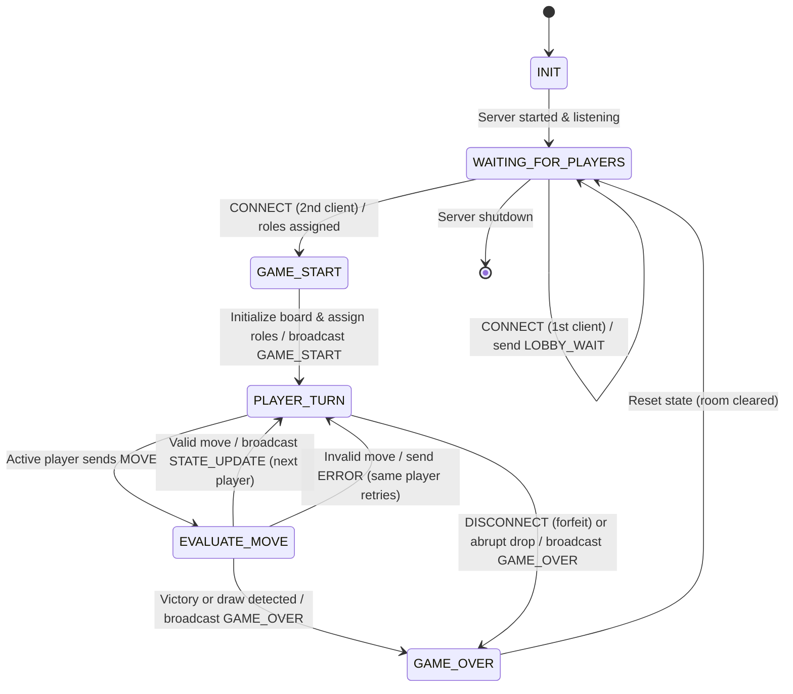
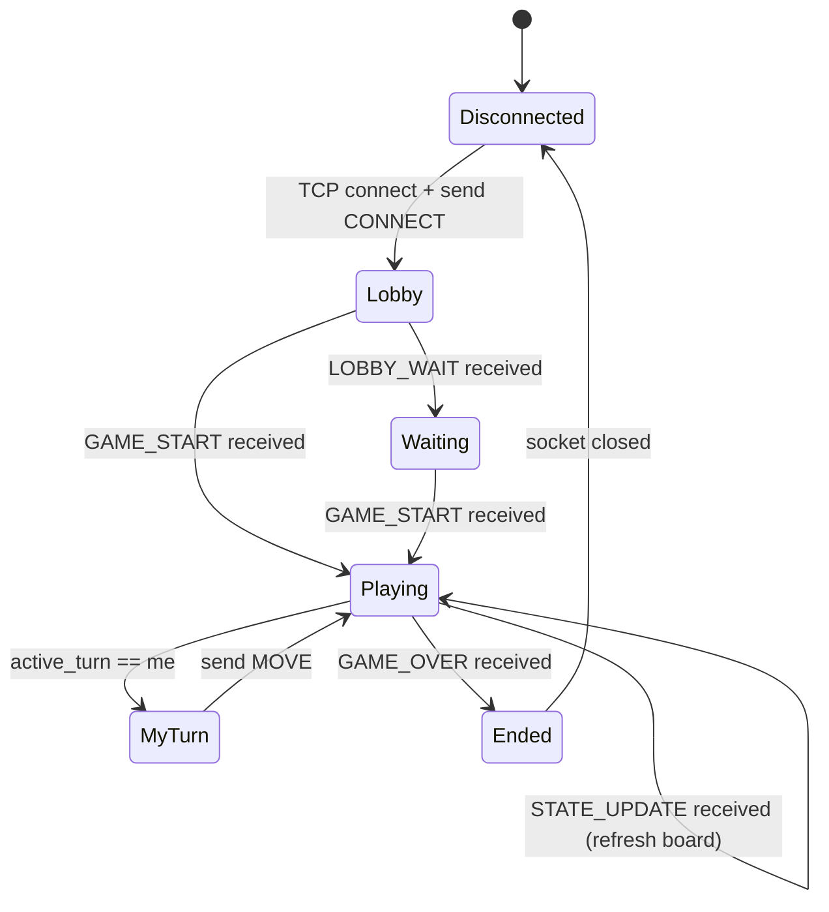

# Game State Machine (FSM) Specification

**Course:** CS 457 — Sprint 1  
**Student:** Abdoul Kadre Tiemtore  
**Document:** `fsm_specification.md`  

---

## 1. Purpose

This document specifies the **server-side finite state machine (FSM)** that governs every game room. The FSM is the single source of truth.

---

## 2. States

| State                 | Description                                                                                                             |
| --------------------- | ----------------------------------------------------------------------------------------------------------------------- |
| `INIT`                | Server process starting: binds the listening socket.                                                                    |
| `WAITING_FOR_PLAYERS` | Listening; fewer than 2 valid clients connected.                                                                        |
| `GAME_START`          | Both clients connected; roles assigned (Player 1 = X, Player 2 = O), board initialized, `GAME_START` broadcast pending. |
| `PLAYER_TURN`         | Waiting for a `MOVE` from the active player.                                                                            |
| `EVALUATE_MOVE`       | Validating the submitted move (turn, range, cell occupancy) and applying it.                                            |
| `GAME_OVER`           | Terminal outcome reached (win / draw / forfeit). Final state broadcast, cleanup.                                        |

---

## 3. FSM Diagram (Mermaid `stateDiagram-v2`)

---

## 4. State Transition Table

| Current State         | Event                   | Guard / Condition                                 | Action                                                    | Next State            |
| --------------------- | ----------------------- | ------------------------------------------------- | --------------------------------------------------------- | --------------------- |
| `INIT`                | socket bound            | port free                                         | start accept loop                                         | `WAITING_FOR_PLAYERS` |
| `WAITING_FOR_PLAYERS` | `CONNECT`               | 1st valid alias                                   | assign role X, send `LOBBY_WAIT`                          | `WAITING_FOR_PLAYERS` |
| `WAITING_FOR_PLAYERS` | `CONNECT`               | 2nd valid alias                                   | assign roles, init board                                  | `GAME_START`          |
| `WAITING_FOR_PLAYERS` | `CONNECT`               | room already full                                 | send `ERROR ROOM_FULL`, close socket                      | `WAITING_FOR_PLAYERS` |
| `WAITING_FOR_PLAYERS` | TCP EOF / RST           | pending client left                               | remove client, log                                        | `WAITING_FOR_PLAYERS` |
| `GAME_START`          | entry action            | —                                                 | broadcast `GAME_START`, set active player = X             | `PLAYER_TURN`         |
| `PLAYER_TURN`         | `MOVE`                  | sender == active player, coords valid, cell empty | apply move, broadcast `STATE_UPDATE`                      | `EVALUATE_MOVE`       |
| `PLAYER_TURN`         | `MOVE`                  | out of turn                                       | send `ERROR OUT_OF_TURN`                                  | `PLAYER_TURN`         |
| `PLAYER_TURN`         | `MOVE`                  | bad coords / occupied cell                        | send `ERROR INVALID_MOVE`                                 | `PLAYER_TURN`         |
| `PLAYER_TURN`         | `MOVE`                  | malformed / unknown type                          | send `ERROR MALFORMED_MESSAGE`                            | `PLAYER_TURN`         |
| `PLAYER_TURN`         | `DISCONNECT`            | either player                                     | declare forfeit, `GAME_OVER(FORFEIT)` to opponent         | `GAME_OVER`           |
| `PLAYER_TURN`         | TCP EOF / RST / timeout | either player's socket                            | same as intentional disconnect (opponent wins by forfeit) | `GAME_OVER`           |
| `EVALUATE_MOVE`       | evaluation done         | no winner, board not full                         | switch active player                                      | `PLAYER_TURN`         |
| `EVALUATE_MOVE`       | evaluation done         | 3-in-a-row or board full                          | send `GAME_OVER(WIN|DRAW)` to both                        | `GAME_OVER`           |
| `GAME_OVER`           | cleanup done            | —                                                 | close sockets, clear room, reset board                    | `WAITING_FOR_PLAYERS` |

---

## 5. Edge Case Handling

### 5.1 Out of turn moves

A `MOVE` whose `player_id` ≠ `active_turn` never touches the board. The server emits `ERROR OUT_OF_TURN` and stays in `PLAYER_TURN` — the FSM state is unchanged, so a misbehaving client cannot corrupt the game.

### 5.2 Invalid payloads

- Malformed JSON / schema violations → `ERROR MALFORMED_MESSAGE`, connection kept, state unchanged (single-strike policy; `FRAME_TOO_LONG` instead closes the connection).
- Coordinates outside 0–2 or an occupied cell → `ERROR INVALID_MOVE`; the same (legitimately active) player may retry.

### 5.3 Client disconnects

All three termination paths from `protocol_blueprint.md` map to the same transition:

| Path              | Detection                                                                                   | Transition                          |
| ----------------- | ------------------------------------------------------------------------------------------- | ----------------------------------- |
| Intentional quit  | `DISCONNECT` message                                                                        | `PLAYER_TURN → GAME_OVER` (forfeit) |
| Clean close (FIN) | `recv()` returns `b""` (EOF)                                                                | `PLAYER_TURN → GAME_OVER` (forfeit) |
| Crash / link drop | `ConnectionResetError`, `BrokenPipeError`, `ConnectionAbortedError`, or 30 s `TimeoutError` | `PLAYER_TURN → GAME_OVER` (forfeit) |

In every case the surviving opponent receives `GAME_OVER` with `outcome:"FORFEIT"` and is credited the win; sockets are closed and the room is reclaimed. A disconnect during `WAITING_FOR_PLAYERS` simply clears the pending slot — the FSM never leaves that state.

---

## 6. Client-Side FSM 

---

